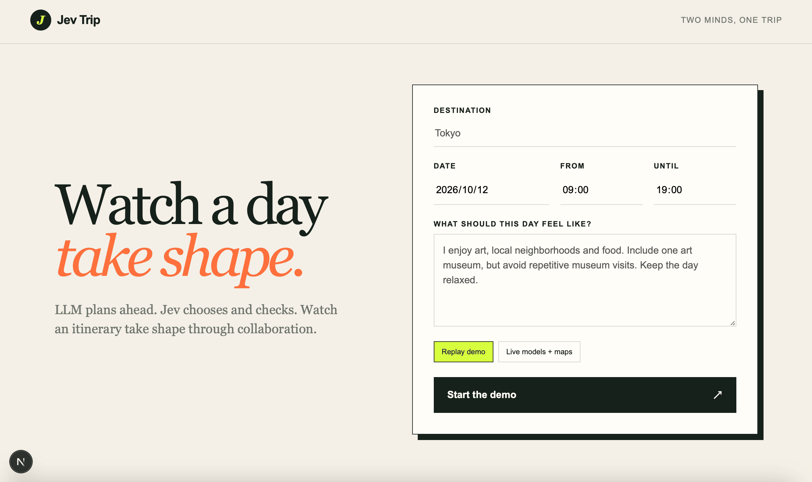

# Daymark

**Two Minds, One Trip.**

Daymark is an explainable day-trip planner. The LLM plans ahead; Jev chooses and checks. Deterministic code handles route facts, time calculations, validation, and versioning.



## How it works

```text
Places + routes ──→ LLM Planner ──→ Draft itinerary
                         ↕                  │
                    Jev decisions           │
                         ↑                  ↓
                    Controller ←── review, validate, repair
```

- **LLM Planner** chooses the next activity and repairs flagged plans.
- **Jev** screens candidates, compares transport options, answers typed planning questions, and reviews the itinerary.
- **Controller** owns facts and rules: timing, routes, IDs, versions, validation, and retry limits.

The interface uses English for product controls and system states. User preferences and planning explanations follow the user's language; place names and transit lines remain in their original language.

## Try it

```sh
npm install
cp .env.example .env.local
npm run dev -- --hostname 127.0.0.1 --port 3100
```

Open [http://127.0.0.1:3100](http://127.0.0.1:3100).

- **Replay demo** is a local scripted run with no credentials or network calls. Start it, then replay or scrub through every planning and repair event.
- **Live models + maps** uses Geoapify places/routes, Groq, and Jev.

Live mode requires:

```env
GEOAPIFY_API_KEY=
TYPESAFE_API_KEY=
GROQ_API_KEY=
GROQ_MODEL=
```

Optional configuration is documented in [.env.example](.env.example).

## Verify

```sh
npm test
npm run typecheck
npm run build
```

## Current scope

This product plans a single day in USA cities using Geoapify. It supports real POIs and route options, typed Jev decisions, streamed planning events, bounded repair, and replay/export of a run. Supabase Auth and Supabase Postgres are planned for optional saved trips.

It does not yet support multi-day trips, bookings, accounts, persistent history, or verified opening hours. Visit durations are estimates, and every result should be treated as a draft rather than a guaranteed executable itinerary.

## References

- [Jev Choice](https://docs.typesafe.ai/primitives/choice)
- [Jev model limitations](https://docs.typesafe.ai/model-jaggedness/jev-1.13)
